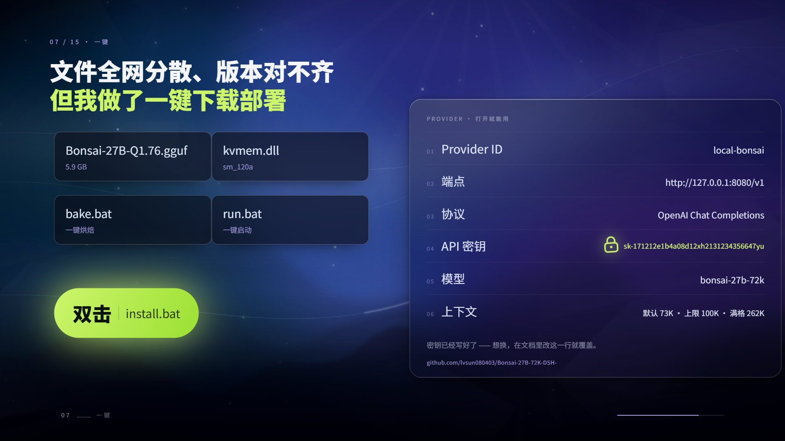
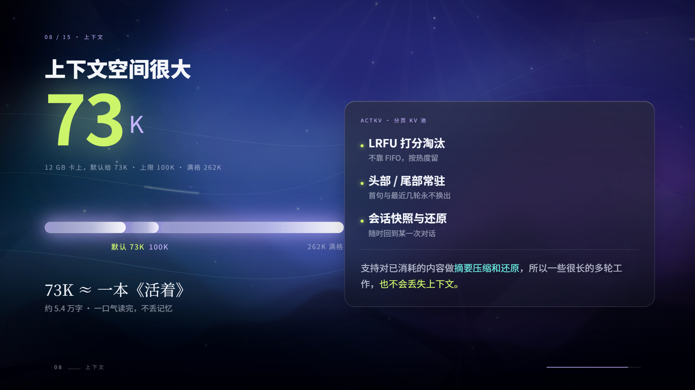
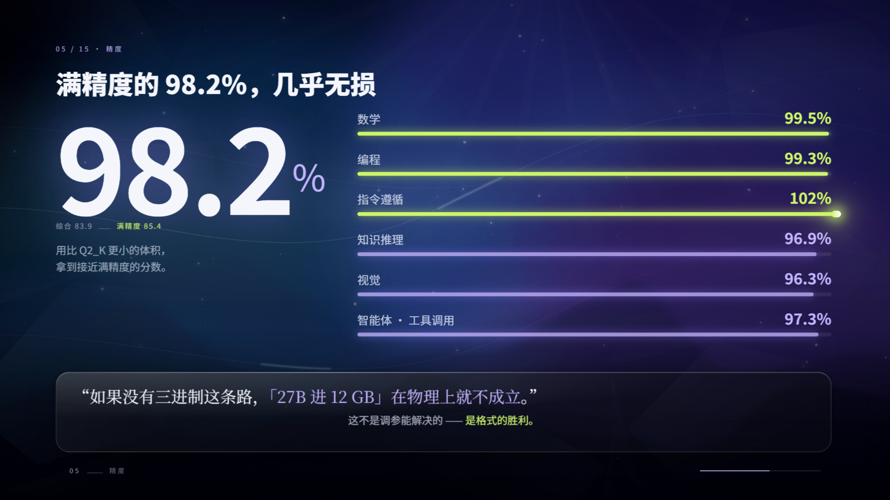

<!-- 放到仓库根目录；图片路径按仓库内文件名引用 -->
<div align="center">

# Bonsai 27B · 72K · 一键部署

**双击 `install.bat`，十分钟后，你的 12 GB 笔记本上跑着一个 27B 模型。**

三重（Ternary）权重 · 8.87 GB 模型 · 73,728 上下文 · 实测 57–66 tok/s · 全程离线

[](#)
[](#)
[](#)
[](#)
[](#)

[一键部署](#-一键部署三步) · [我的优化](#-我做了什么优化) · [实测数据](#-实测数据) · [DSH 插件](#-自带-dsh-插件) · [已知坑](#-已知坑必读) · [English](#english)

</div>

---

## 这张图就是全部卖点



> 上游把模型、引擎、KV 管理、三进制内核拆在四个仓库、若干网盘和一堆 bat 里，版本互相对不上。
> 这个仓库把它们**拼成一个文件夹**：双击 `install.bat`，等进度条走完，双击 `start.bat`，完事。

---

## 这是什么

一个**能在消费级显卡上跑 27B** 的自包含部署包。模型不是量化到半残的 Q4，而是把权重压成三进制（−1 / 0 / +1）再配分组缩放，等效 **1.76 bit**，却保住了原模型 **98.2%** 的分数。

| | |
|---|---|
| 模型 | `Ternary-Bonsai-2-27B-ninfer-v3.ninfer` · **9,520,051,456 B（8.87 GiB）** |
| 基座 | Qwen3.8-27B（27B 稠密、64 层、hidden 5120、词表 248,320、原生 262,144 上下文） |
| 精度 | 三进制权重 + FP16 分组缩放，官方口径保留 **98.2%**（综合 83.9 vs 85.4） |
| 引擎 | NInfer（KVMem v0.18.0 · Windows · RTX 50 系 `sm_120a` 构建） |
| 默认上下文 | **73,728** token ≈ 11.9 万汉字 ≈ 一整本《活着》 |
| 显存占用 | 约 **10.5 GB**（12 GB 卡上的实测峰值） |
| 解码速度 | **57–66 tok/s**（长答）；短答 65–71 tok/s |
| 预填充 | 564–724 tok/s（8K–71K 提示） |
| 依赖 | 不需要 CUDA Toolkit、不需要 Python、不需要 WSL —— 只要驱动够新 |

<div align="center">


</div>



---

## 🚀 一键部署三步

```text
① 双击 install.bat     下载 → 校验 SHA256 → 解压 → 写配置（首次约 10.4 GB）
② 双击 start.bat       加载引擎（约 5 秒），打印 Base URL / 模型名 / API Key
③ 打开 http://127.0.0.1:18200
```

就这三步。没有 Python 环境、没有 `pip`、没有编译。

<details>
<summary><b>它到底做了什么（点开）</b></summary>

1. **环境自检**：64 位 / Windows 10+ / `curl` / 显卡 `compute_cap` 必须是 12.0（RTX 50 系）/ 磁盘 ≥ 22 GB；缺 VC++ 运行库会自动下载安装。
2. **引擎**：从镜像下载 `kvmem-v0.18.0-ninfer-windows-rtx50-sm120a.zip`（900,767,487 B），SHA256 逐字节校验后解压拍平。
3. **权重**：下载 `Ternary-Bonsai-2-27B-ninfer-v3.ninfer`（9,520,051,456 B），同样校验 SHA256。
4. **API Key**：首次运行自动写入 `api-key.txt`（默认 `sk-171212e1b4a08d12xh2131234356647yu`）。
5. **启动**：`scripts\serve.ps1` 组装参数，后台拉起引擎，轮询 `/health` 直到 200。

重跑是安全的：已经下好的文件会显示“已存在”并跳过。
</details>

---

## 🔧 我做了什么优化

上游能给的是一个**能用但难用**的组合。下面每一条都是踩过坑之后改的，括号里是实测数字。

| # | 问题 | 我做的处理 | 效果 |
|---|---|---|---|
| 1 | 官方只有 sm_89 / sm_86 构建，RTX 50 系加载即崩 | 换用 **`sm_120a`** 通用构建，并确认二进制里含 `t2_g128` 三进制内核 | 12 GB 笔记本卡可直接跑 |
| 2 | 默认开 CUDA Graph，启动阶段 `cudaErrorGraphExecUpdateFailure` | 固定 `--no-cuda-graph` | 能启动，速度几乎无损失 |
| 3 | 默认 KV 类型吃显存 | 换 **`rk4v4`**（4-bit KV） | 上下文 20,480 → **65,536**，再调到 **73,728** |
| 4 | 预填充慢（长文档等不起） | `--fast-prefill-kernel` + `--prefill-chunk 512` | 71K 提示 564 tok/s |
| 5 | 投机解码草稿宽度不会选 | A/B 测出 `--draft-tokens 2` 最稳 | 长答 55–60 tok/s（4/6 反而掉到 42–45） |
| 6 | 主机内存只有 16 GB，默认会 pin 9.2 GiB 直接失败 | `--kvmem-host-mib 2048` + `--kvmem-sessions 2` | 内存占用降到约 2 GB，服务能起来 |
| 7 | 下载源动不动断流 | 多源兜底（镜像优先、**直连永远排最后**）+ `--ssl-no-revoke` + 断点续传 + 45 秒卡死看门狗 | 一次装完，不用人盯着 |
| 8 | 进度看不见 | 自绘单行原地刷新进度条（`[####----] 42.3% 3.76 GB / 8.87 GB 12.4 MB/s ETA 06:52`） | 一眼能判断“是否在正常下” |
| 9 | 包内文件散、版本对不上 | 引擎与权重全部 SHA256 校验；同盘用**硬链接**安装，不重复占空间 | 装完即用，可复现 |
| 10 | 双击 bat 出来的窗口关不掉进程 | `stop.bat` 只杀**本端口**的进程，不误杀别的模型 | 多模型共存不串台 |

> 完整调参记录、断电矩阵、失败尝试都在 [`使用说明.html`](使用说明.html)。

---

## 📊 实测数据

三档上下文，同一台机器（RTX 5070 Ti Laptop 12 GB / i7 / 16 GB RAM / 驱动 591.91）：

| 提示长度 | 预填充 | 首字延迟 | 解码 |
|---|---|---|---|
| 20,046 token | 679 tok/s | 29.5 s | 57.1 tok/s |
| 48,083 token | 604 tok/s | 79.7 s | 58.9 tok/s |
| 70,331 token | 564 tok/s | 124.7 s | 66.5 tok/s |

**结论：解码速度基本不随上下文变慢**（57–66 tok/s），变慢的只有首字延迟，约每 1 万 token +1.7 秒。前缀缓存生效时，同一段 8K 提示的第二次首字从 11.0 s 掉到 0.18 s。

<details>
<summary><b>与其他方案的对比（点开）</b></summary>

| | 本仓库（Bonsai 27B / 三进制） | Qwen3.5-9B Q4_K_XL | 27B Q4（常规量化） |
|---|---|---|---|
| 权重体积 | **8.87 GiB** | 5.56 GiB | 16.5 GiB |
| 参数 | 27B | 8.95B | 27B |
| 12 GB 显存 | ✅ 10.5 GB | ✅ 9.4 GB | ❌ 装不下 |
| 上下文 | 73,728 | 131,072 | — |
| 预填充 | 564–724 tok/s | 2,813 tok/s | — |
| 解码 | 57–66 tok/s | 55.5 tok/s | — |
| 同题正确率（15 题） | 11/15 | 11/15 | — |

一句话：**它不是“更聪明的 9B”，而是“你机器上唯一能跑的 27B”**。
</details>

---

## 🎛 自带 DSH 插件

仓库里的 `dsh-local-model-toggle-plugin-0.6.0.zip` 是一个 DeepSeek Harness 插件（也是我写的）：

- **左侧栏底部一个胶囊开关**：左键启停，右键弹菜单
- **自动识别** DSH 配置里所有本地模型（`127.0.0.1` / `localhost`），右键切换，**不会串台**
- 每个模型独立记录部署夹与上下文长度
- 闲置 N 分钟自动关停，把显存还给游戏
- 找不到部署夹时红点提示，右键选目录

装法：解压 → 双击 `install.bat` → **完全退出 DSH 再打开**。

---

## 📁 目录结构

```text
.
├── install.bat             ← 双击这个
├── start.bat / stop.bat / status.bat
├── 重置下载.bat             ← 下载卡死时清缓存重来
├── api-key.txt             ← 首次安装自动生成
├── scripts\
│   ├── install.ps1         安装：自检 / 下载 / 校验 / 解压 / 写 key
│   └── serve.ps1           启动：组参数 / 拉进程 / 等 /health
├── engine\                 引擎（安装后生成）
├── model\                  权重（安装后生成，同盘硬链接）
├── download\ / run\        下载缓存与运行日志
├── 使用说明.html            完整说明书（12 章）
└── dsh-local-model-toggle-plugin-0.6.0.zip
```

---

## ⚠️ 已知坑（必读）

1. **别同时开 `--prefill-chunk 4096` 和 `--prefill-cublas`**。我这台机器上这个组合会**整机断电**（Kernel-Power 41，`BugcheckCode=0`，无蓝屏无过热），单独用任一个都正常。默认配置已经避开。
2. 默认上下文 73K，不是 262K。满 262,144 需要 16 GB 卡（官方口径：16 GB 卡上约 7 GB 出头显存）。
3. 走的是私有格式（`.ninfer`），**stock llama.cpp 读不了**，必须用包内引擎。
4. 三进制内核跑在 CUDA 上，Windows + RTX 50 系是验证过的组合；40 系要换 `sm_89` 构建。
5. 首次加载约 5 秒，之后靠系统文件缓存，基本瞬开。

---

## ❓FAQ

<details><summary><b>能跑在 8 GB 显存上吗？</b></summary>
官方口径可以（8 GB 即可运行），但会牺牲上下文；我这边的 12 GB 配置是「73K 上下文 + 满载还剩 1.2 GB」的折中。
</details>

<details><summary><b>为什么不用 Ollama / LM Studio？</b></summary>
它们还不支持三进制权重（`t2_g128_fp16` 是 PrismML 的私有张量类型），加载会直接报 `invalid ggml type 143`。
</details>

<details><summary><b>它会不会瞎编？</b></summary>
会。同题实测里“虚构条约”一题，它和 9B 都编了，只是编的年份不同。27B 不等于不幻觉。
</details>

<details><summary><b>能商用吗？</b></summary>
权重与基座是 Apache-2.0，但请自行核对上游许可；本仓库只做“把它们拼起来 + 调好参数”。
</details>

---

## 🙏 致谢与来源

| 角色 | 来源 |
|---|---|
| 基座模型 | Qwen3.8-27B（Apache-2.0） |
| 三进制压缩 | PrismML |
| ActKV 思路 / KVMem | 中国科学技术大学（[arXiv:2609.31395](https://arxiv.org/abs/2609.31395)） |
| 引擎构建 | kvmem v0.18.0（NInfer · Windows sm_120a） |
| 三进制构件 | WaveCut（HuggingFace） |
| 部署包 · 调参 · DSH 插件 | 本仓库 |

**新仓库地址**：<https://github.com/lvsun080403/Bonsai-27B-72K-DSH->

> 如果你也在这套东西上踩过坑，欢迎开 issue 补充；参数是拿真机一档一档试出来的，有更优组合请告诉我。

---

<a id="english"></a>

# 🇬🇧 English

<div align="center">
<b>Double-click <code>install.bat</code>. Ten minutes later, a 27B model runs on your 12 GB laptop.</b>
</div>

---

## What this is

A self-contained Windows deployment bundle that puts a **27B ternary-quantized model** on a consumer GPU. The weights are packed as {−1, 0, +1} with group-wise scaling — effectively **1.76 bit** — while keeping **98.2%** of the original model's benchmark score.

| | |
|---|---|
| Model | `Ternary-Bonsai-2-27B-ninfer-v3.ninfer` · **8.87 GiB** |
| Base | Qwen3.8-27B (27B dense · 64 layers · 262,144 native context) |
| Engine | NInfer / KVMem v0.18.0 · Windows · RTX 50-series `sm_120a` build |
| Default context | **73,728 tokens** (~119k Chinese chars) |
| VRAM | ~**10.5 GB** (peak, measured on a 12 GB laptop) |
| Decode | **57–66 tok/s** long-form · 65–71 tok/s short answers |
| Prefill | 564–724 tok/s |
| Requirements | No CUDA Toolkit, no Python, no WSL — just a recent driver |

## 🚀 Three steps

```text
1. double-click install.bat    download → verify SHA256 → extract → write config (~10.4 GB)
2. double-click start.bat      load engine (~5 s), prints Base URL / model / API key
3. open http://127.0.0.1:18200
```

<details>
<summary><b>What the installer actually does</b></summary>

1. Pre-flight: 64-bit / Windows 10+ / `curl` / GPU `compute_cap == 12.0` (RTX 50) / ≥ 22 GB free disk; auto-installs the VC++ runtime if missing.
2. Downloads the engine zip (900,767,487 B) from a mirror, verifies SHA256, extracts and flattens the layout.
3. Downloads the weights (9,520,051,456 B) and verifies SHA256.
4. Writes `api-key.txt` on first run.
5. `scripts\serve.ps1` assembles the launch flags, starts the engine in the background and polls `/health`.

Re-running is safe — finished files are detected and skipped.
</details>

## 🔧 What I actually changed (and why)

| # | Problem | Fix |
|---|---|---|
| 1 | Only sm_89/sm_86 builds upstream → instant failure on RTX 50 | Switched to the **`sm_120a`** build; verified `t2_g128` kernels inside the binary |
| 2 | Default CUDA Graphs crashed at startup (`cudaErrorGraphExecUpdateFailure`) | Forced `--no-cuda-graph` |
| 3 | Default KV type ate VRAM | Switched to **`rk4v4`** (4-bit KV): 20,480 → 65,536 → **73,728** tokens |
| 4 | Slow prefill on long docs | `--fast-prefill-kernel` + `--prefill-chunk 512` → 564 tok/s at 71K |
| 5 | Speculative-decoding draft width untuned | A/B measured `--draft-tokens 2` as best (55–60 tok/s; 4/6 dropped to 42–45) |
| 6 | Default pins 9.2 GiB host RAM → fails on 16 GB machines | `--kvmem-host-mib 2048` + `--kvmem-sessions 2` |
| 7 | Downloads stall constantly | Multi-mirror failover (**direct connection always last**), `--ssl-no-revoke`, resume, 45 s stall watchdog |
| 8 | No visibility while downloading | Single-line inline progress bar with speed and ETA |
| 9 | Scattered files, mismatched versions | SHA256 for engine + weights; hard-link install on the same volume |
| 10 | Double-clicked bat leaves zombie processes | `stop.bat` kills only the process on **its own port** |

## 📊 Measured

RTX 5070 Ti Laptop (12 GB) · 16 GB RAM · driver 591.91:

| Prompt | Prefill | TTFT | Decode |
|---|---|---|---|
| 20,046 tok | 679 tok/s | 29.5 s | 57.1 tok/s |
| 48,083 tok | 604 tok/s | 79.7 s | 58.9 tok/s |
| 70,331 tok | 564 tok/s | 124.7 s | 66.5 tok/s |

Decode is essentially flat across context length; only TTFT grows (~+1.7 s per 10k tokens). With prefix caching, a repeated 8K prompt drops TTFT from 11.0 s to 0.18 s.

## 🎛 Bundled DSH plugin

`dsh-local-model-toggle-plugin-0.6.0.zip` adds a pill switch at the bottom-left of DeepSeek Harness: left-click to start/stop, right-click to pick among **all** local models discovered from your DSH config (loopback only), each with its own deploy folder and context size. Idle auto-stop frees the GPU for games.

## ⚠️ Known issues

1. **Never combine `--prefill-chunk 4096` with `--prefill-cublas`** — on this machine that combination hard-resets the whole laptop (Kernel-Power 41, no BSOD, no overheating). Either one alone is fine. The defaults avoid it.
2. Default context is 73K, not 262K. The full 262,144 window needs a 16 GB card.
3. Proprietary container (`.ninfer`) — stock llama.cpp cannot read it; use the bundled engine.
4. Validated on Windows + RTX 50 (`sm_120a`); 40-series needs the `sm_89` build.

## 🙏 Credits

Base model **Qwen3.8-27B** (Apache-2.0) · ternary packing by **PrismML** · ActKV/KVMem research by **USTC** ([arXiv:2609.31395](https://arxiv.org/abs/2609.31395)) · engine build **kvmem v0.18.0** · ternary artifact by **WaveCut**. Packaging, tuning and the DSH plugin by this repo.

**Repo**: <https://github.com/lvsun080403/Bonsai-27B-72K-DSH->

<div align="center"><sub>If this saved you a weekend, a ⭐ helps other people find it.</sub></div>
